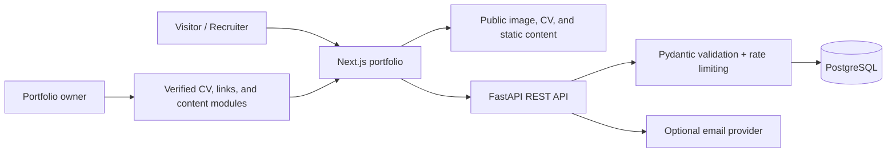

# Dibya Ayishwarja Mallick — Data & AI Portfolio

A responsive, dark technical portfolio for Dibya Ayishwarja Mallick, focused on analytics, business intelligence, machine learning, applied AI, and data engineering. Stable portfolio content is rendered statically by Next.js; FastAPI and PostgreSQL provide the server-side foundation for contact submissions and privacy-conscious visitor analytics.

## Architecture



The MVP deliberately keeps verified profile, experience, skills, education, and project content in typed frontend modules. The backend handles the validated, rate-limited contact form and anonymous visitor analytics. Public feedback and a content-management UI remain deferred until they have a clear privacy and maintenance purpose.

The analytics panel at the bottom of the portfolio reports distinct anonymous browser sessions and aggregate visitors by country. It includes a start/end date slicer on the right and refreshes the filtered summary every 30 seconds. It stores a keyed hash of a session identifier, never a raw IP address or raw session identifier. Country data is read from trusted hosting proxy headers when available; local development may show `Unknown`.

## Technology

- Frontend: Next.js 16 App Router, React, TypeScript, Tailwind CSS
- Backend: FastAPI, Pydantic, SQLAlchemy 2.x, Alembic
- Persistence: PostgreSQL 16
- Operations: Docker Compose, GitHub Actions CI

## Repository layout

```text
frontend/       Next.js application, typed portfolio content, public assets
backend/        FastAPI modular monolith, database models, API tests
essentials/     Private source materials; never served publicly
docs/           Architecture documentation
infra/          Reserved for deployment configuration
```

## Local development

### Frontend

Requires Node.js 22+.

```bash
cd frontend
npm ci
npm run dev
```

Open <http://localhost:3000>. Verify with `npm run lint`, `npx tsc --noEmit`, and `npm run build`.

### Backend

Requires Python 3.12+ and PostgreSQL 16+.

```bash
cd backend
python -m venv .venv
# Windows PowerShell: .venv\Scripts\Activate.ps1
python -m pip install -e ".[dev]"
alembic upgrade head
uvicorn app.main:app --reload --port 8000
```

API documentation is available at <http://localhost:8000/docs>. Liveness is at `/api/v1/health`; readiness is at `/api/v1/ready`.

### Docker Compose

Docker is optional for frontend-only work and is not installed in the current development environment. When Docker is available:

```bash
docker compose up --build
```

This starts the frontend on port 3000, the API on port 8000, and PostgreSQL on port 5432. The backend waits for PostgreSQL, applies `alembic upgrade head`, and then starts FastAPI. The Compose database password defaults to `change_me` for local development only; use a strong secret outside local development.

## Verified content and assets

The public profile content was prepared from the CV, profile photo, and project-links spreadsheet in `essentials/`. Only the approved photo derivative and CV copy are placed under `frontend/public`. The source directory remains private and is ignored by Git. External project links should be reviewed again before production launch.

## Delivery status

- [x] Phase 0: inspect source materials and reconcile verified content
- [x] Phase 1: establish brand tokens and responsive portfolio foundation
- [x] Phase 2: add experience, skills, projects, education, certifications, CV, SEO, sitemap, and robots
- [x] Phase 3: FastAPI health/readiness, contact form, persistence model, rate limiting, and initial Alembic schema
- [x] Phase 3 enhancement: anonymous visitor counts and aggregate country summary
- [ ] Runtime verification: run the Compose stack and verify contact submission against PostgreSQL
- [ ] Phase 4: production URL, accessibility/performance checks, HTTPS, backups, and monitoring

See [SYSTEM_ARCHITECTURE.md](SYSTEM_ARCHITECTURE.md) for the complete system design and implementation roadmap.

## License

Private — All rights reserved.
