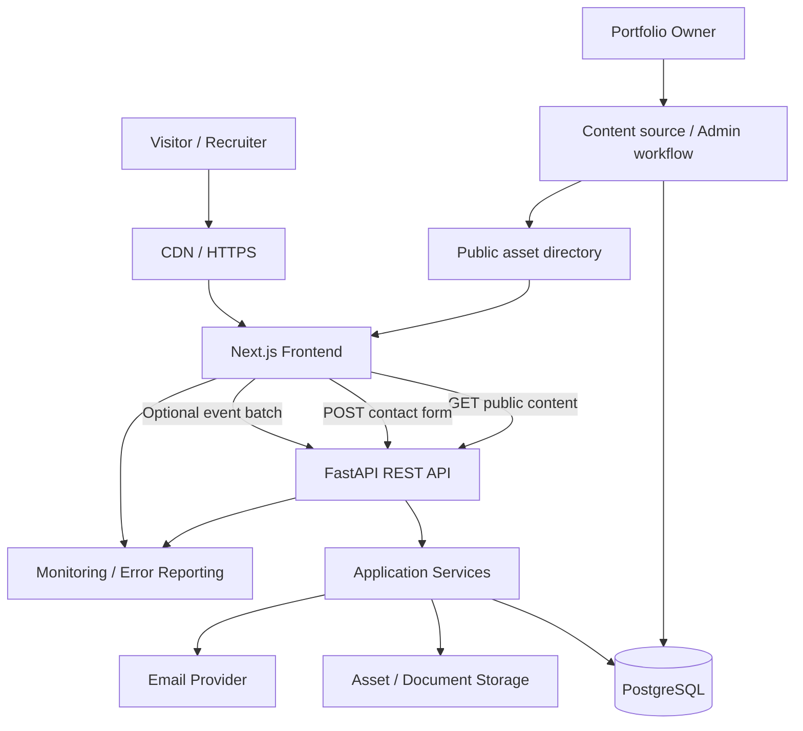
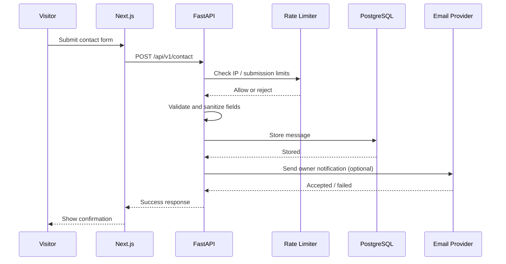
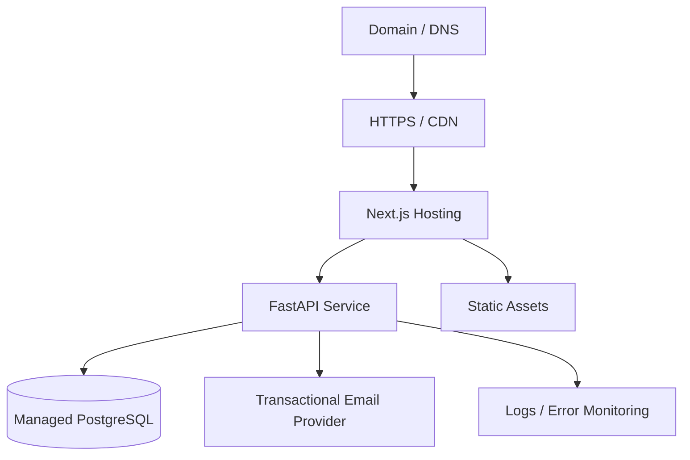

# Personal Portfolio — System Architecture

**Owner:** Dibya Ayishwarja Mallick  
**Architecture version:** 1.0  
**Status:** Proposed  
**Reference:** https://iamrad.info/  
**Primary brand color:** `#00072D`

---

## 1. Project vision

Build a polished, responsive, data-professional portfolio inspired by the information architecture and interaction patterns of [iamrad.info](https://iamrad.info/), but with original content, visual identity, and implementation.

The portfolio should position its owner around:

- Data Analytics and Business Intelligence
- Data Science and Machine Learning
- Applied AI and NLP
- Data engineering and automation

It should communicate professional experience, technical depth, project outcomes, education, and contact information. It should be fast, accessible, discoverable by search engines, maintainable, and straightforward to update as projects and experience evolve.

### Core technology decisions

| Layer | Technology | Responsibility |
|---|---|---|
| Frontend | Next.js (App Router), TypeScript | Pages, routing, rendering, SEO |
| UI system | Tailwind CSS, shadcn/ui | Design tokens and reusable components |
| Motion | Framer Motion / Motion | Deliberate transitions and interaction |
| Backend | FastAPI, Python | REST API, validation, business logic |
| Database | PostgreSQL | Contact submissions, reviews, portfolio content if dynamic |
| ORM / migrations | SQLAlchemy 2.x, Alembic | Persistence and schema evolution |
| Data validation | Pydantic | API request/response contracts |
| Asset storage | Local public assets initially; object storage later | Profile image, CV, documents, project media |
| Analytics | Privacy-conscious first-party event tracking | Page visits and aggregate engagement |
| Deployment | Docker, reverse proxy, managed hosting/VPS | Reproducible deployment |

The first release should avoid unnecessary microservices. A modular monolith is sufficient for a personal portfolio.

---

## 2. Product scope

### 2.1 Main sections

1. **Home / Hero**
   - Terminal-style greeting or status line.
   - Name, professional headline, concise introduction.
   - Profile photograph.
   - Primary actions: View projects, Download CV, Contact.
   - Availability or current professional focus, if accurate.

2. **About**
   - Short professional narrative.
   - Career direction and areas of interest.
   - Selected highlights supported by verifiable facts.

3. **Experience**
   - Chronological timeline.
   - Organization, role, location, dates, and responsibilities.
   - Expandable details, outcomes, tools, and supporting media.
   - Include the upay Revenue Assurance and Business Intelligence experience and the NPSB UAT contribution, using wording verified against the CV and source material.

4. **Skills**
   - Grouped skills rather than an unstructured logo wall.
   - Suggested groups: Analytics & BI, Programming, Data Science & ML, Databases, Data Engineering, Tools & Collaboration.
   - Interactive map or constellation is optional; a responsive accessible list must remain available.

5. **Projects**
   - Featured project cards with problem, approach, stack, outcome, and links.
   - Categories such as Analytics & BI, Data Science & ML, Data Engineering, Applied AI.
   - Project detail pages for substantial work.
   - Support GitHub, live demo, dashboard, report, and dataset links where available.
   - Do not invent project metrics or claim production deployment without evidence.

6. **Education**
   - Degree, institution, dates, relevant coursework, and academic information confirmed by the CV.

7. **Certifications & Achievements**
   - Verified certificates, hackathon participation, competitions, and achievements.
   - Status labels must distinguish completed, participating, and in-progress.

8. **Resume**
   - View and download the approved CV PDF.
   - Provide a clear fallback if the file is unavailable.

9. **Contact**
   - Email and verified professional links.
   - Validated contact form with server-side spam controls.
   - Clear success and error states.

10. **Optional engagement**
    - Lightweight visitor analytics.
    - Optional rating / feedback feature only if it has a clear purpose and moderation controls.

### 2.2 MVP versus later enhancements

| Priority | Feature |
|---|---|
| MVP | Responsive home, about, experience, skills, projects, education, CV, contact |
| MVP | Links and profile data sourced from `essential` |
| MVP | FastAPI health endpoint and contact API |
| MVP | PostgreSQL persistence for contact submissions |
| MVP | SEO metadata, sitemap, robots, Open Graph |
| Phase 2 | Project detail pages and project filters |
| Phase 2 | Aggregate analytics dashboard |
| Phase 2 | Moderated visitor feedback |
| Phase 2 | Content-management interface |
| Phase 3 | Rich interactive skills visualization |
| Phase 3 | External dashboard embeds and case-study visualizations |

---

## 3. High-level system architecture



### Request flow

1. A visitor opens the portfolio URL.
2. The CDN or hosting platform serves the Next.js application and static assets.
3. Next.js renders the page using server-side rendering or static generation where appropriate.
4. Public content is read from a version-controlled content source or FastAPI endpoint.
5. A visitor submitting the contact form sends a request to FastAPI.
6. FastAPI validates and rate-limits the request, persists it in PostgreSQL, and optionally triggers an email notification.
7. Operational logs and errors are sent to the configured monitoring service.

### Architectural principle

Use **static or server-rendered content for stable portfolio information** and the backend for operations that genuinely require server-side processing or persistence. Do not make the portfolio depend on a live API call for every piece of content if the same information can be safely built into the frontend at deploy time.

---

## 4. Frontend architecture

### 4.1 Next.js application

Use the Next.js App Router with TypeScript.

Suggested route structure:

```text
frontend/
├── public/
│   ├── images/
│   ├── documents/
│   ├── logos/
│   └── projects/
├── src/
│   ├── app/
│   │   ├── (portfolio)/
│   │   │   ├── page.tsx
│   │   │   ├── about/page.tsx
│   │   │   ├── experience/page.tsx
│   │   │   ├── projects/page.tsx
│   │   │   ├── projects/[slug]/page.tsx
│   │   │   ├── skills/page.tsx
│   │   │   ├── education/page.tsx
│   │   │   └── contact/page.tsx
│   │   ├── api/                 # Only if a Next.js route handler is justified
│   │   ├── layout.tsx
│   │   ├── globals.css
│   │   ├── sitemap.ts
│   │   └── robots.ts
│   ├── components/
│   │   ├── layout/
│   │   ├── navigation/
│   │   ├── hero/
│   │   ├── experience/
│   │   ├── skills/
│   │   ├── projects/
│   │   ├── education/
│   │   ├── contact/
│   │   └── ui/                  # shadcn/ui generated components
│   ├── content/
│   │   ├── profile.ts
│   │   ├── experience.ts
│   │   ├── skills.ts
│   │   ├── projects.ts
│   │   ├── education.ts
│   │   └── certifications.ts
│   ├── lib/
│   │   ├── api-client.ts
│   │   ├── constants.ts
│   │   ├── metadata.ts
│   │   └── utils.ts
│   └── types/
│       ├── portfolio.ts
│       └── api.ts
├── components.json
├── next.config.ts
├── package.json
└── Dockerfile
```

### 4.2 Component design

Build the UI from reusable sections and smaller components. Suggested components:

- `SiteHeader`, `MobileNavigation`, `SiteFooter`
- `TerminalIntro`, `ProfileHero`, `AvailabilityBadge`
- `SectionHeading`, `MetricHighlight`
- `ExperienceTimeline`, `ExperienceCard`
- `SkillCategory`, `SkillGrid`, `SkillNetwork`
- `ProjectGrid`, `ProjectCard`, `ProjectFilter`, `ProjectDetail`
- `EducationCard`, `CertificationCard`
- `ResumeDownload`
- `ContactForm`, `SocialLinks`

Use shadcn/ui for primitives such as Button, Card, Badge, Tabs, Dialog, Accordion, Tooltip, Input, Textarea, Select, and Sonner. Customize them through design tokens rather than leaving the default shadcn appearance unchanged.

### 4.3 Rendering strategy

- Use Server Components by default.
- Use Client Components only for interactive elements: filters, menus, animations requiring browser state, skill visualization, and form interactions.
- Use static generation for stable profile, project, and experience content.
- Use dynamic rendering only where fresh server data is required.
- Load third-party embeds lazily and provide a lightweight link or screenshot fallback.
- Avoid embedding large dashboards above the fold.

### 4.4 Frontend data strategy

For the MVP, keep non-sensitive portfolio content in typed content modules or JSON files. This provides fast builds, easy review, and no runtime API dependency for static sections.

Use the FastAPI backend for:
- Contact form submission.
- Optional visitor event ingestion.
- Optional review submission.
- Future content management.

If a database-backed CMS is introduced later, keep the frontend data access behind a typed API client so the data source can change without rewriting UI components.

---

## 5. Backend architecture

### 5.1 FastAPI modular monolith

Suggested structure:

```text
backend/
├── app/
│   ├── main.py
│   ├── core/
│   │   ├── config.py
│   │   ├── logging.py
│   │   ├── security.py
│   │   └── rate_limit.py
│   ├── api/
│   │   ├── deps.py
│   │   └── v1/
│   │       ├── router.py
│   │       ├── health.py
│   │       ├── contact.py
│   │       ├── analytics.py
│   │       └── feedback.py
│   ├── schemas/
│   │   ├── contact.py
│   │   ├── analytics.py
│   │   └── feedback.py
│   ├── models/
│   │   ├── contact.py
│   │   ├── visitor_event.py
│   │   └── feedback.py
│   ├── services/
│   │   ├── contact_service.py
│   │   ├── email_service.py
│   │   ├── analytics_service.py
│   │   └── feedback_service.py
│   ├── repositories/
│   │   ├── contact_repository.py
│   │   ├── analytics_repository.py
│   │   └── feedback_repository.py
│   └── db/
│       ├── session.py
│       └── base.py
├── alembic/
├── tests/
├── alembic.ini
├── pyproject.toml
└── Dockerfile
```

### 5.2 API versioning and endpoints

Base path: `/api/v1`

| Method | Endpoint | Purpose | MVP |
|---|---|---|---|
| GET | `/health` | Liveness check | Yes |
| GET | `/ready` | Database/dependency readiness | Yes |
| POST | `/contact` | Validate and save a message | Yes |
| GET | `/portfolio/profile` | Public profile payload, if API-driven | Optional |
| GET | `/portfolio/projects` | Project listing, if API-driven | Optional |
| GET | `/portfolio/projects/{slug}` | Project detail, if API-driven | Optional |
| POST | `/analytics/events` | Ingest minimal event batch | Later |
| GET | `/analytics/summary` | Protected owner analytics | Later |
| POST | `/feedback` | Submit rating/comment | Later |
| GET | `/feedback` | Read approved feedback only | Later |

Use Pydantic request and response schemas. Return consistent error responses and document the API through FastAPI's OpenAPI interface.

### 5.3 Contact form workflow



Important behavior:
- Do not expose email-provider credentials in the frontend.
- Store the message before attempting notification.
- Email failure must not erase a successfully stored contact message.
- Add a honeypot field and rate limiting; consider CAPTCHA only if abuse warrants it.
- Do not expose a public endpoint to list private contact submissions.

### 5.4 Database design

Use PostgreSQL for backend features requiring persistence. A minimal MVP schema:

**contact_messages**
- `id` UUID primary key
- `name` VARCHAR(120)
- `email` VARCHAR(254)
- `subject` VARCHAR(180), nullable
- `message` TEXT
- `created_at` TIMESTAMPTZ
- `status` VARCHAR(20), default `new`
- `source_page` VARCHAR(200), nullable

Optional later tables:

**visitor_events**
- `id` UUID primary key
- `event_name` VARCHAR(80)
- `page_path` VARCHAR(300)
- `referrer_domain` VARCHAR(200), nullable
- `country_code` CHAR(2), nullable if reliably supplied
- `session_id_hash` VARCHAR(128), nullable
- `created_at` TIMESTAMPTZ

**feedback**
- `id` UUID primary key
- `display_name` VARCHAR(100), nullable
- `rating` SMALLINT with a 1–5 constraint
- `comment` VARCHAR(1000), nullable
- `status` VARCHAR(20), default `pending`
- `created_at` TIMESTAMPTZ

Do not collect unnecessary personal data. Define retention and deletion policies before enabling analytics or public feedback.

### 5.5 Database access

- SQLAlchemy 2.x for ORM and query execution.
- Alembic for migrations.
- One database session per request / unit of work.
- Use repository functions for database operations and service functions for business rules.
- Use connection pooling appropriate to the deployment platform.
- Never expose database credentials to Next.js browser code.

---

## 6. `essential` folder and asset ingestion

The project is expected to contain an `essential/` folder with:
- A Google Sheet containing relevant external links.
- Profile photograph.
- CV PDF.

The actual folder contents have not been inspected as part of this architecture preparation. Therefore, filenames, sheet columns, link values, and document contents must be discovered during implementation rather than assumed.

### 6.1 Recommended repository placement

```text
portfolio-project/
├── essential/                  # Source material; do not publish blindly
│   ├── profile-photo.*
│   ├── cv.pdf
│   ├── linkedin-profile.pdf
│   └── links-sheet-reference.*
├── frontend/
├── backend/
├── infra/
├── docs/
│   └── SYSTEM_ARCHITECTURE.md
├── .gitignore
└── README.md
```

Keep the original `essential/` directory outside the public web root. Do not copy the entire directory into `frontend/public`.

### 6.2 Asset processing workflow

1. Inspect the directory and identify actual filenames and file formats.
2. Inspect the Google Sheet structure and extract verified URLs and labels.
3. Review the CV and LinkedIn Profile to reconcile professional history, dates, project names, and skills.
4. Confirm the profile image and generate optimized web derivatives (for example WebP/AVIF) without altering identity-defining facial features.
5. Copy only approved public assets into `frontend/public/images` or `frontend/public/documents`.
6. Keep original source documents in `essential/` and exclude private or working files from deployment.
7. Create a typed `profile.ts` and related content modules from verified source information.
8. Check every external URL and every document download before launch.

Suggested public asset names after inspection and approval:

```text
frontend/public/
├── images/
│   └── profile.webp
└── documents/
    └── dibya-mallick-cv.pdf
```

The LinkedIn profile PDF should not automatically be published. Review it for private contact details or information that should not be public; prefer linking to the public LinkedIn profile when possible.

### 6.3 Google Sheet integration decision

For a personal portfolio, do not make the public website fetch a private Google Sheet on every page load.

Preferred approach:
- Treat the sheet as a source-of-truth reference during content preparation.
- Export or read it during a controlled content update.
- Validate links and store approved values in typed frontend content files.
- If frequent updates become necessary, introduce a secure server-side Google Sheets integration later. Credentials must remain server-side and must never be committed to Git.

---

## 7. Visual design system

### 7.1 Brand foundation

Primary color: `#00072D` (deep navy).

Suggested supporting palette:

| Token | Value | Use |
|---|---|---|
| `--background` | `#00072D` | Main page background |
| `--surface` | `#07143D` | Cards and elevated surfaces |
| `--surface-muted` | `#0D1B4A` | Secondary panels |
| `--foreground` | `#F4F6FF` | Main text |
| `--muted-foreground` | `#AAB4D0` | Secondary text |
| `--border` | `#26345F` | Dividers and card borders |
| `--accent` | `#67E8F9` | Interactive accent |
| `--accent-secondary` | `#8B9CFF` | Secondary highlight |
| `--success` | `#6EE7B7` | Positive state |
| `--warning` | `#FBBF24` | Warning state |

These are proposed supporting colors; adjust after checking contrast in the implemented design. The primary brand color remains fixed.

### 7.2 Visual direction

- Dark, modern, technical, and restrained.
- Terminal-inspired details used as accents, not as a readability obstacle.
- Strong typographic hierarchy and generous spacing.
- Fine borders, subtle glows, and restrained gradients.
- Clear project cards with visible outcomes and calls to action.
- Consistent icon style.
- Responsive behavior across mobile, tablet, and desktop.
- Respect `prefers-reduced-motion`.
- All interactive elements must have keyboard focus states and accessible labels.

### 7.3 Design tokens

Define colors, radius, shadows, typography, and spacing centrally using CSS variables compatible with shadcn/ui. Avoid hardcoding colors separately in every component.

---

## 8. Content model

Use a consistent content contract even if the initial source is TypeScript or JSON.

### Profile

```ts
type Profile = {
  name: string;
  headline: string;
  summary: string;
  location?: string;
  email?: string;
  image: string;
  cvUrl?: string;
  socialLinks: {
    label: string;
    url: string;
  }[];
};
```

### Experience

```ts
type Experience = {
  id: string;
  organization: string;
  role: string;
  location?: string;
  employmentType?: string;
  startDate: string;
  endDate?: string;
  summary: string;
  achievements: string[];
  technologies: string[];
  logo?: string;
  mediaUrl?: string;
};
```

### Project

```ts
type Project = {
  id: string;
  slug: string;
  title: string;
  category: string;
  shortDescription: string;
  problem?: string;
  approach?: string;
  outcomes: string[];
  technologies: string[];
  image?: string;
  githubUrl?: string;
  liveUrl?: string;
  reportUrl?: string;
  featured: boolean;
};
```

### Skill

```ts
type Skill = {
  name: string;
  category: string;
  proficiencyLabel?: string;
  evidence?: string;
};
```

Avoid numeric proficiency scores unless there is a defensible and consistent method for assigning them. Evidence through projects and experience is more credible.

---

## 9. Security and privacy

### Frontend
- Keep secrets out of `NEXT_PUBLIC_*` variables.
- Validate forms client-side for usability and server-side for security.
- Restrict external embeds to trusted domains.
- Use a restrictive Content Security Policy where practical.
- Avoid rendering untrusted HTML.
- Set secure headers and HTTPS.

### Backend
- Use environment variables or a deployment secret manager.
- Validate all input with Pydantic and enforce length limits.
- Apply IP-based and endpoint-specific rate limits.
- Configure CORS for the exact production frontend origin; do not use wildcard origins with credentials.
- Use parameterized ORM queries.
- Avoid returning stack traces or internal error details to clients.
- Protect owner-only analytics and administrative endpoints with authentication.
- Add spam protection to contact and feedback endpoints.
- Apply request-size limits and safe logging; never log message contents or secrets unnecessarily.

### Data handling
- Publish only approved CV and profile assets.
- Keep original PDFs and the source spreadsheet out of public directories unless explicitly approved.
- Establish retention for contact messages and analytics.
- Use minimal, aggregated analytics. Avoid fingerprinting.
- Provide a privacy notice if collecting contact submissions, analytics, or feedback.

---

## 10. Performance, accessibility, and SEO

### Performance
- Optimize images with `next/image`.
- Use modern image formats and responsive sizes.
- Lazy-load below-the-fold media and external dashboard embeds.
- Avoid excessive animation libraries and large client bundles.
- Use static generation for stable content.
- Cache public GET responses where appropriate.
- Compress responses and enable CDN caching for static assets.
- Set performance budgets and inspect Core Web Vitals.

### Accessibility
- Semantic HTML and a logical heading hierarchy.
- Keyboard-accessible navigation, forms, tabs, and filters.
- Visible focus indicators.
- Sufficient color contrast, especially muted text on navy.
- Alternative text for meaningful images.
- Reduced-motion support.
- Do not encode meaning using color alone.

### SEO
- Unique title and description metadata.
- Open Graph and social sharing image.
- Canonical URL.
- `sitemap.xml` and `robots.txt`.
- Structured data such as `Person` and `CreativeWork` where appropriate and accurate.
- Descriptive project URLs and headings.
- Ensure the main portfolio content is indexable without requiring client-side interaction.

---

## 11. Deployment architecture

### 11.1 Recommended deployment shape

For a first deployment, use managed hosting for Next.js and a managed Python service or a small VPS for FastAPI and PostgreSQL.



A single VPS with Docker Compose is also viable for a cost-conscious deployment, but it places more responsibility on the owner for operating-system updates, backups, monitoring, TLS, and incident recovery.

### 11.2 Docker Compose for local development

```text
services:
  frontend:
    build: ./frontend
    ports:
      - "3000:3000"
    environment:
      NEXT_PUBLIC_API_BASE_URL: http://localhost:8000

  backend:
    build: ./backend
    ports:
      - "8000:8000"
    env_file:
      - ./backend/.env
    depends_on:
      - db

  db:
    image: postgres:16
    environment:
      POSTGRES_DB: portfolio
      POSTGRES_USER: portfolio_user
      POSTGRES_PASSWORD: ${POSTGRES_PASSWORD}
    volumes:
      - postgres_data:/var/lib/postgresql/data

volumes:
  postgres_data:
```

This is an illustrative local-development configuration. Production should use strong secrets, persistent storage, health checks, migration execution, backups, and restricted network exposure. Do not commit `.env` files.

### 11.3 Environment variables

Backend examples:

```env
APP_ENV=development
DATABASE_URL=postgresql+psycopg://portfolio_user:change_me@db:5432/portfolio
FRONTEND_ORIGIN=http://localhost:3000
SECRET_KEY=replace_with_a_secure_random_value
EMAIL_PROVIDER_API_KEY=
CONTACT_NOTIFICATION_EMAIL=
```

Frontend example:

```env
NEXT_PUBLIC_API_BASE_URL=http://localhost:8000
```

Only values intentionally safe for browser exposure may use the `NEXT_PUBLIC_` prefix.

---

## 12. Testing strategy

| Layer | Test type | Suggested tooling |
|---|---|---|
| Frontend components | Unit/component | Vitest, React Testing Library |
| Frontend flows | End-to-end | Playwright |
| Backend services | Unit | pytest |
| API endpoints | Integration | pytest, FastAPI TestClient / HTTPX |
| Database | Migration/integration | PostgreSQL test service |
| Accessibility | Automated checks | axe |
| Performance | Lighthouse / Web Vitals | Lighthouse |
| Security | Dependency and static checks | pip-audit, npm audit, Bandit |

Critical test cases:
- Navigation works on mobile and desktop.
- CV download points to the approved document.
- Every social and project link is valid.
- Contact form validates required fields and malformed email addresses.
- Rate limits reject abusive submissions.
- Database failure produces a safe error response.
- Email notification failure does not lose the stored message.
- No private asset or secret is present in the production build.
- Main content remains usable with JavaScript interactions disabled where feasible.

---

## 13. CI/CD and repository workflow

Suggested repository:

```text
portfolio-project/
├── frontend/
├── backend/
├── essential/                  # Local source material; gitignored
├── infra/
│   ├── docker/
│   └── deployment/
├── docs/
│   └── SYSTEM_ARCHITECTURE.md
├── .github/
│   └── workflows/
│       ├── frontend-ci.yml
│       └── backend-ci.yml
├── .gitignore
├── docker-compose.yml
└── README.md
```

CI pipeline:
1. Install dependencies.
2. Run formatting and lint checks.
3. Run frontend and backend tests.
4. Run type checking.
5. Build Next.js.
6. Build backend container.
7. Deploy only after checks pass on the protected deployment branch.

Recommended tools:
- Frontend formatting/lint: ESLint and Prettier.
- Python formatting/lint: Ruff.
- Python typing: mypy or Pyright, as project complexity warrants.
- Dependency lockfiles committed to version control.
- Separate development and production environment variables.

Example `.gitignore` entries:

```gitignore
.env
.env.*
!.env.example
essential/
**/__pycache__/
.pytest_cache/
.venv/
node_modules/
.next/
dist/
coverage/
*.log
```

If a sanitized, approved public asset is intentionally version-controlled, place it in the frontend public directory; do not unignore the whole `essential/` folder.

---

## 14. Observability and maintenance

- Add `/health` for process liveness and `/ready` for dependency readiness.
- Use structured logs with request IDs.
- Monitor API error rate, latency, and database availability.
- Track frontend runtime errors.
- Configure database backups and periodically test restoration.
- Monitor domain and TLS certificate expiry.
- Keep dependencies updated and review security advisories.
- Keep analytics aggregate and minimal.

A portfolio does not need a complex observability stack initially. Hosting logs, uptime monitoring, and an error-reporting service are sufficient for the MVP.

---

## 15. Implementation roadmap

### Phase 0 — Source inspection and content verification
- Inspect `essential/`.
- Identify the image, CV, LinkedIn PDF, and Google Sheet.
- Extract and verify external URLs.
- Reconcile role dates, titles, projects, skills, and achievements against source documents.
- Approve the public content and asset list.

**Exit criterion:** a verified content inventory with no guessed links or claims.

### Phase 1 — Design foundation
- Create Next.js app with TypeScript.
- Configure Tailwind and shadcn/ui.
- Establish the `#00072D` design tokens.
- Build responsive header, footer, typography, buttons, and cards.
- Implement hero and about sections.

**Exit criterion:** responsive visual foundation with consistent tokens.

### Phase 2 — Portfolio content
- Build experience timeline.
- Build skills categories.
- Build project cards and detail pages.
- Add education, certifications, achievements, and CV download.
- Add SEO metadata.

**Exit criterion:** all core portfolio content is present and source-verified.

### Phase 3 — FastAPI and persistence
- Create FastAPI modular structure.
- Configure PostgreSQL, SQLAlchemy, and Alembic.
- Implement health/readiness endpoints.
- Implement contact endpoint, validation, rate limiting, and persistence.
- Add email notification if needed.

**Exit criterion:** contact flow works end-to-end and failures are handled safely.

### Phase 4 — Quality and launch
- Responsive and accessibility testing.
- Validate all URLs and document downloads.
- Optimize images and page performance.
- Configure production CORS, secrets, HTTPS, backups, and monitoring.
- Deploy and verify production behavior.

**Exit criterion:** public site is secure, usable, indexable, and operational.

### Phase 5 — Enhancements
- Add project filtering and richer case studies.
- Add privacy-conscious analytics.
- Add moderated feedback only if useful.
- Add an authenticated content-management workflow if manual content updates become cumbersome.

---

## 16. Key architecture decisions and rationale

| Decision | Rationale |
|---|---|
| Modular monolith instead of microservices | Lower operational complexity for a single-owner portfolio |
| Next.js App Router | Strong SEO, server rendering, static generation, and modern React architecture |
| shadcn/ui | Accessible, composable components that can be customized to the brand |
| FastAPI | Typed Python APIs, Pydantic validation, OpenAPI documentation, and alignment with the owner's Python/data background |
| PostgreSQL | Reliable relational persistence for contact submissions and future dynamic features |
| Static typed content for stable sections | Fast load, lower infrastructure cost, fewer runtime dependencies |
| Keep `essentials/` private | Prevent accidental publication of source documents and spreadsheets |
| Optional analytics | Avoid building a tracking system before there is a clear need |
| No public admin interface in MVP | Reduces attack surface and avoids unnecessary development |

---

## 17. Risks and mitigations

| Risk | Mitigation |
|---|---|
| Incorrect or outdated profile claims | Verify against CV, LinkedIn PDF, and owner approval |
| Private information exposed from source PDFs or Sheet | Keep `essentials/` outside public root; review all public copies |
| External dashboards slow down pages | Lazy-load embeds and provide static previews/links |
| Spam through contact form | Rate limiting, honeypot, validation, optional CAPTCHA |
| API unavailable while static page loads | Keep stable content statically rendered |
| Analytics creates privacy obligations | Minimize collection, aggregate, document retention |
| Over-engineering | Ship MVP before CMS, feedback, and advanced analytics |
| Low contrast on dark background | Test all token combinations against WCAG contrast targets |

---

## 18. Definition of done

The first production release is complete when:

- [ ] The design uses `#00072D` as its primary brand color.
- [ ] The portfolio is responsive across common screen sizes.
- [ ] All content has been verified against the source materials.
- [ ] The profile image and CV are optimized and approved for publication.
- [ ] All social, project, and document links work.
- [ ] Core sections are accessible and keyboard usable.
- [ ] SEO metadata, sitemap, robots, and social preview are configured.
- [ ] FastAPI health and contact endpoints work.
- [ ] Contact submissions persist in PostgreSQL.
- [ ] Rate limiting and server-side validation are active.
- [ ] Secrets and private source files are excluded from the public build and Git.
- [ ] Production HTTPS, backups, and basic monitoring are configured.
- [ ] Critical frontend and backend tests pass.

---

## 19. Reference and implementation notes

The reference site was reviewed for its portfolio information architecture and interaction concepts: terminal-style introduction, measurable highlights, experience timeline, categorized skills, project groupings, live analytics, education, certifications, and contact/feedback sections.

Reference: https://iamrad.info/

This document defines the proposed architecture, not a claim that the local project directory or `essentials/` contents have already been inspected. During implementation, inspect the actual files and verify all content before publishing.

**Recommended implementation order:** inspect `essentials/` → verify content → establish design system → build static portfolio sections → implement FastAPI contact workflow → test and deploy → add optional dynamic features.
